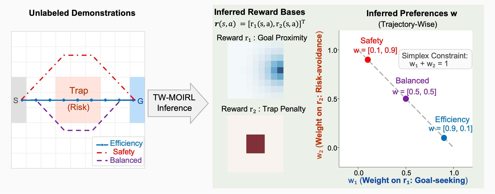

# Trajectory-Wise Continuous Preference Estimation from Unlabeled Navigation Trajectories



This repository contains the implementation of TW-MOIRL and the code for the synthetic gridworld experiments and the mouse navigation case study in our paper.

## Environments

- `GoalPuddle-5x5`
- `TrapGrid-9x9`
- `XYTradeoff-9x9`
- Mouse navigation (10x10 grid, used by `run_mouse.py`)

## Repository Layout

- `run_synthetic.py`: demonstration generation, TW-MOIRL training and evaluation (EVD, r_pair, AUC_inv)
- `run_synthetic.sh`: runs the three gridworlds with the ten seeds used in the paper
- `run_mouse.py`: TW-MOIRL training on the mouse trajectories, figures and the directional permutation test
- `permutation_test.py`: directional permutation test for inferred mouse preferences
- `twmoirl/model.py`: TW-MOIRL
- `twmoirl/mdp.py`: soft value iteration and policy evaluation
- `twmoirl/envs.py`: environments and demonstration generation
- `twmoirl/metrics.py`: evaluation metrics
- `twmoirl/plotting.py`: plotting utilities

## Requirements

- Python 3.10 or later
- Python packages: `torch`, `numpy`, `matplotlib` (tested with PyTorch 2.9.0 on CPU)

Results may differ slightly across platforms.

## Quickstart

### TW-MOIRL with GoalPuddle-5x5

```bash
python run_synthetic.py --env GoalPuddle-5x5 --seed 10
```

Results are appended to `results/synthetic.csv`.

### All gridworlds and seeds

```bash
bash run_synthetic.sh
```

### Mouse navigation

The processed mouse trajectories are available from the corresponding author upon reasonable request. Place the file in this directory, then run:

```bash
python run_mouse.py
```

Results are written to `results/mouse/seedxxx/`, where `xxx` is the optimizer seed derived from `--base_seed` and printed at the end of the run. The default base seed is 10; use `--base_seed 20` (30, ..., 100) for the additional fits in the Supplementary Information.

To run the directional permutation test on saved preferences, replace `xxx` with the optimizer seed:

```bash
python permutation_test.py results/mouse/seedxxx/preferences.csv
```

## License

License: MIT (see LICENSE). The license covers the code only; the mouse trajectory data are not included and are available upon request.
